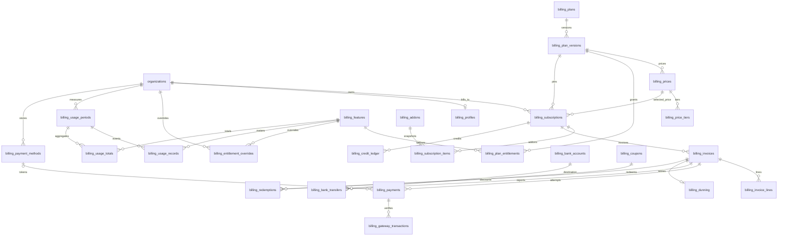

# ClickFix faturalama mimarisi (CF-18)

Bu karar CF-18'in veri modeli temelidir. Bu değişiklik şema ve bütünlük
kurallarını kurar; HTTP API, tahsilat, zamanlanmış işler ve e-Arşiv sağlayıcısı
sonraki maddelerin teslimidir. Hiçbir canlı sağlayıcı varsayılan olarak açılmaz.

## Kapsam ve sahiplik

ClickFix satıcı, organizasyon müşteridir. Global katalog tabloları
`billing_plans`, `billing_plan_versions`, `billing_prices`, `billing_price_tiers`,
`billing_features`, `billing_plan_entitlements`, `billing_addons`,
`billing_coupons` ve satıcının `billing_bank_accounts` tablosudur. Diğer tablolar
organizasyon kapsamındadır. Her müşteri tablosunda `organization_id` ve indeks
vardır. Çocuk ilişkiler `(organization_id, id)` foreign key kullanır; yanlış
organizasyona ait fatura, abonelik veya kart bağlanamaz. Repository sorguları
ayrıca `orgctx` kapsamını filtreler. Platform yöneticisinin organizasyonlar arası
listesi ayrı yetkilendirilir. Kayıtlar finansal geçmişi korumak için varsayılan
RESTRICT davranışıyla silmeye kapalıdır; organizasyonlar soft delete edilir.

## Katalog ve sürümleme

Plan kimliği, adı, açıklaması, görünürlüğü (`public`, `hidden`, `custom`), sırası
ve arşiv tarihi değiştirilebilir. Ticari şartlar sürüme aittir. Her sürümün plan
başına artan numarası, deneme süresi, fiyatları ve özellik değerleri vardır.
Taslak düzenlenir, tek transaction içinde doğrulanıp yayımlanır. Yayımlanmış sürüm,
fiyatı, kademesi ve entitlement satırı DB trigger ile INSERT/UPDATE/DELETE'e
kapatılır. Çocuk düzenlemeleri sürüm satırını kilitler; yayınlama ile yarışamaz.
Yayımlanmış sürüm silinmez; yeni satışlar planı arşivleyerek kapatılır.

Abonelik hem `plan_version_id` hem o sürüme ait `price_id` tutar. Yeni sürüm
çıktığında mevcut abonelik değişmez (grandfathering). Toplu taşıma ancak açık
bir yönetici işlemi, önizleme, audit kaydı ve dönem sınırında uygulanır.
Fiyat kademeleri `[lower_bound, upper_bound)` aralıklarıdır; NULL üst sınır sonsuzdur.
CF-19 yayınlama doğrulaması boşluk/çakışma, son açık kademe, fiyat ve entitlement
bütünlüğünü kontrol eder. Şema tek başına tam bir satışa hazır sürüm doğrulamaz.
Add-on fiyatı satın alındığında subscription item'a kopyalanır; katalog fiyatı
sonradan değişse de mevcut item etkilenmez. Add-on değiştirme de audit gerektirir.

## Tutar, para birimi, KDV ve kur

CF-18'in açık kararı gereği tutarlar `BIGINT *_minor` ile en küçük para biriminde
saklanır: 129900 = 1.299,00 TRY. Bu, genel boilerplate `numeric` para kuralından
belgelenmiş sapmadır; floating point kullanılmaz. API integer kabul eder; Go
hesaplarında taşma kontrol edilir, oran işlemlerinde `math/big` kullanılır.
TRY/USD/EUR fiyatları aylık ve yıllık ayrı satırlardır. Yıllık fiyat aylığın 12
katı varsayılmaz. Sabit bedel + koltuk başına bedel + kullanım kademeleri ayrıdır.
Kullanım kademeleri graduated olarak uygulanır; satır açıklaması fiyat kaynağını
ve miktarı fatura anında dondurur.

KDV oranı fiyatta basis point olarak açıkça belirlenir (2000 = %20); mevzuat
oranı kodda varsayılmaz. `tax_inclusive=false` fiyat net tutardır. Dahil fiyatlarda
net = brüt × 10000 / (10000 + oran). İndirim vergi öncesi uygulanır. Her fatura
satırında half-up ile en yakın kuruşa yuvarlanır, toplamlar yuvarlanmış satırlardan
alınır. Header eşitliği DB CHECK ile korunur; satır toplamı eşitliği invoice
servisinin transaction içi doğrulamasıdır. Yayımlanmış faturanın satırları
sonradan yeniden hesaplanmaz; düzeltme iade/iptal akışına gider.

Tahsilat ve fatura TRY'dir. USD/EUR liste fiyatı, fatura taslağı oluşturulurken
TCMB döviz satış kuru ile TRY'ye çevrilir. Kur kaynağı, efektif yayın zamanı,
kaynak para birimi ve oran (`NUMERIC(20,8)`) faturada dondurulur. Hafta sonu ve
tatilde en son yayımlanan iş günü verisi kullanılır; veri yoksa fiyatlama durur.
TRY için oran 1, kaynak `identity` olur. Sağlayıcı callback'i, ödeme tarihi veya
retry fiyatı/kurunu değiştirmez. TCMB adaptörü ve veri güncelliği kontrolü sonraki
teslimdir; bu karar canlı kur entegrasyonu bulunduğu anlamına gelmez.

## Abonelik, trial ve plan değişimi

Bir organizasyonda `trialing`, `active`, `past_due`, `grace`, `paused`
durumlarından yalnızca bir canlı abonelik bulunabilir. `canceled` ve `expired`
satırlar geçmişte kalır. Dönemler UTC `[başlangıç,bitiş)` aralığıdır. Aylık/yıllık
ilerleme takvim ayı ile yapılır; ay sonu hedef ayın son gününe sıkıştırılır.
Deneme süresi sürümün `trial_days` değerinden gelir. Organizasyon signup akışı
CF-23'te transaction/outbox ile trial oluşturur; aynı organizasyona tekrar trial
verilmez. Hatırlatmalar outbox tüketicisi üzerinden notifications'a gider.

Geçiş matrisi CF-22'de tek state machine ve her geçiş için table-driven test ile
uygulanacaktır. Öngörülen akış: trialing → active/expired/canceled;
active → past_due/paused/canceled; past_due → active/grace/canceled;
grace → active/expired/canceled; paused → active/canceled/expired.
Terminal abonelik yeniden açılmaz; yeni abonelik açıkça oluşturulur.
Cancel-at-period-end bir işaret olup erişim dönem sonuna kadar sürer.

Aynı para birimi ve fatura aralığında upgrade farkı
`ceil((yeni_net - eski_net) × kalan_süre / toplam_süre)` olarak kuruşa yuvarlanır;
fark faturalanır ve ödeme doğrulandıktan sonra sürüm değişir. Downgrade dönem
sonuna planlanır, nakit iade doğurmaz. Aralık/para birimi değişikliği dönem sonunda
yapılır. Belirsiz tahsilat varken yeni upgrade/renewal başlatılmaz. Denemeden
ücretliye geçişte ilk tam dönem bedeli alınır; deneme gününe ücret çıkarılmaz.

## Entitlement ve ölçüm

Etkin hak = sabitlenmiş sürüm + aktif subscription item'lar + süresi geçmemiş
organizasyon override. Boolean değerler ve sayısal limitler ayrı tiplenir.
Sınırsız değer açık `unlimited=true` ile gösterilir; eksik özellik erişim vermez.
Override nedeni ve yapan kişi kaydedilir. Etkin durum CF-20'de TTL'li Redis
`app:<env>:entitlements:<org_uuid>` anahtarında tutulur; DB doğrudur.
Abonelik/override değişince invalidation outbox ile yapılır. `Require` ve
`CheckLimit` typed hata ve i18n kodu döndürür. İptal/sona ermede salt okuma ve
fatura ödeme açık kalırken yeni tüketim kapanır.

Sayaçlar: seats, channels, storage.bytes anlık gauge; conversations.monthly,
ai.tokens ve ai.credits aylık sum. Kullanım dönemleri UTC takvim ayıdır; yıllık
abonelikte de aylık sıfırlanır. Gauge değerleri kaynak tablolardan uzlaştırılır;
yeni ayda sıfırlanmış gauge yanlışlıkla erişim sağlamaz. Kullanım olayları
organizasyon + idempotency key ile tekildir. Aynı key farklı içerikle gelirse
conflict olur. Olay ekleme, aggregate güncelleme ve eşik outbox kaydı tek
transaction'dır. Hard limit için kontrol ve rezervasyon aynı kilit altında
yapılır; soft limit tüketimi sürdürüp sinyal üretir. Negatif miktar yalnızca
gauge azaltma veya açık düzeltme olayıdır; toplam negatif olamaz. Dönem çakışması,
geç olayın ait olduğu dönem ve kapalı dönem düzeltme politikası CF-21 servisinde
kontrol edilir. Şema ilişkiyi tutar, tek başına bu kontrolleri sağlamaz.

## Ödeme, dunning, banka ve fatura

Yenilemeyi ClickFix yönetir; gateway abonelik takvimini yönetmez. Gateway port'u
checkout/3DS init, imzalı callback doğrulama, refund, tokenizasyon ve recurring
charge sağlar. PayTR/iyzico ayrı adaptör, fake yalnız test içindir. Kart PAN/CVV
saklanmaz; sağlayıcı token'ları şifreli ve merchant account UUID'sine bağlıdır.
Gateway transaction tablosunda yalnız digest ve güvenli sonuç kodu tutulur;
ham callback veya token loglanmaz.

Ödeme bir tahsilat denemesidir. Tek faturada yalnız bir `pending`/`unknown`
deneme bulunabilir. Network timeout başarısız tahsilat anlamına gelmez; unknown
mutabakat bekler ve tekrar tahsilatı engeller. Doğrulanmış callback'in event key'i
tekilleştirilir; tutar/para birimi/merchant eşleştirmesi ve invoice settlement aynı
transaction'da yapılır. İade orijinal payment'a bağlı ayrı denemedir; toplam
iade sınırı ödeme satırı kilidi altında kontrol edilir.

Dunning ilk başarısızlığa göre 1., 3., 7. gün yeniden dener; grace 14. gün biter.
`next_attempt_at`, lease, attempts ve çözüm tarihi kalıcıdır; Asynq yalnız
uyandırır. Bilinmeyen ödeme körlemesine yeniden denenmez. Worker çökse de ödeme
claim'i önce kalıcılaşır. Hatırlatma ve state değişimi aynı transaction'da
outbox'a girer; notification tüketicisi kendi event id'siyle tekilleştirir.

Havale/EFT'de banka hesabı satıcıya aittir. Müşteri dekontu özel storage anahtarı
ile raporlar; tutar, alıcı ve fatura kontrolünden sonra yetkili platform kullanıcısı
onaylar/reddeder. Onay atomik olarak payment + invoice settlement üretir.
Dekont yüklemek tek başına ödeme sayılmaz. İade ve banka onayı activity'ye yazılır.
IBAN şekli DB'de, checksum ve banka doğrulaması servis katmanında denetlenir.

Invoice alıcı/satıcı adresi ve kalemleri snapshot olarak saklar. e-Arşiv durumu
ödeme durumundan ayrıdır; hook outbox üzerinden idempotent çalışır. Sağlayıcı
hatası tahsil edilmiş ödemeyi geri almaz. UUID iç kimlikten ayrı dış kimliktir;
fatura numarası seri/yıl kilitli sayacıyla sonraki fatura maddesinde üretilir.

## Kupon ve kredi defteri

Kupon yüzde veya sabit tutardır, ikisi birlikte olamaz. Redemption faturadaki
indirim tutarını dondurur. Geçerlilik/üst kullanım sınırı coupon satırı kilidiyle
CF-19 sonrası kupon entegrasyonunda denetlenir. Mevcut tablo bu entegrasyonun
hook'udur; kupon API'si sağladığı iddia edilmez.

İlk teslimde genel muhasebe için çift kayıtlı defter kurulmaz: ClickFix müşteri
parası tutan cüzdan değildir. TRY kredisi ve AI kredisi ayrı birimlerle append-only
`billing_credit_ledger` girdileridir. Bakiye girdilerin toplamıdır; düzenleme
ters kayıtla yapılır. Idempotency, tek reversal ve UPDATE/DELETE yasağı DB'de korunur; girdiler
yalnız eklenebilir. Kredi harcama kilidi sonraki entegrasyonda uygulanır. Kullanım,
gateway ve redemption olayları da aynı append-only korumaya sahiptir. Muhasebe entegrasyonu eklenirse dengeli çift kayıtlı
posting ayrı bir karar ve migration olur; bu tablo muhasebe defteri yerine geçmez.

## Referanslar ve sapmalar

| Repo | Yol | Uyarlanan karar |
|---|---|---|
| takwim-app-go | `backend/migrations/000095_billing.up.sql`, `backend/internal/modules/billing/model/types.go` | Org bileşik FK, merchant'a bağlı kart, tahsilat belirsizliği, retry lease |
| takwim-app-go | `backend/internal/platform/entitlement/entitlement.go` | Boolean/limit ayrımı, typed limit hatası |
| comcode-app-go | `backend/migrations/000022_entitlement_and_companies.up.sql`, `000023_payment_and_plan_pricing.up.sql` | Özellik kataloğu, fiyat/trial, checkout ayrımı |
| comcode-app-go | `backend/migrations/000054_subscription_dunning.up.sql`, `backend/internal/modules/billing/usecase/renewal.go`, `plan_change.go` | Retry takvimi, kalıcı claim, unknown mutabakat, proration, dönem sonu downgrade |
| otopoly-go | `backend/migrations/000064_billing_core.up.sql`, `000066_billing_invoices.up.sql`, `backend/internal/modules/billing/usecase/types.go` | Özellik dönemleri, banka onayı, invoice snapshot ve e-Arşiv durum ayrımı |
| rentopia-app-go | `backend/internal/modules/payments/model/model.go` | Ödeme/iade ayrımı, maskeli sağlayıcı verisi, doğrulanmış sonuç |

Referansların değiştirilebilir plan fiyatına karşı sürüm kilidi eklendi; CF-19'un
grandfathering kabulü bunu gerektiriyor. Kullanıcı/hesap/şirket abonelikleri
organizasyona uyarlandı. Genel para kuralına karşı integer minor unit CF-18'in
özel kararıdır. Referansların ürünlerine özgü rezervasyon/şube/iş sayacı alınmadı.
CF-18 permission veya route eklemez; ilgili maddede permission migration + RBAC
sabitleri + frontend permission kaydı ve tüm i18n girdileri birlikte eklenecektir.

## CF-19 / CF-20 / CF-22 uygulama sözleşmesi

- Platform kataloğu `/v1/platform/plans` altında yönetilir. `PUT` metadata değiştirir,
  `DELETE` arşivler. Taslak sürüm tüm özellikler için tipli değerleri, aylık/yıllık
  TRY/USD/EUR fiyatlarını, KDV ve koltuk bedelini, isteğe bağlı `[lower,upper)` kullanım
  kademelerini içerir. Son kademe üst sınırı null olur; arada boşluk/çakışma kabul edilmez.
- `/v1/public/pricing` yalnız public ve arşivlenmemiş planların son yayınlanmış sürümünü
  verir. Yayınlama monotoniktir; mevcut aboneliğin sürüm/fiyat bağı değişmez.
  `/v1/platform/plan-migrations` en fazla 100 açık organizasyon/abonelik çiftine aynı
  planın yeni sürümünü dönem sonunda uygulanmak üzere yazar. Aralık ve para birimi korunur.
  Ödeme doğrulayan adaptör ileri dönem sınırlarıyla `Transition(...active...)` çağırınca
  bekleyen sürüm uygulanır; migration API'si ücret almaz.
- `entitlements.Service.Require`, `CheckLimit`, `RequireWritable` ortak motor yüzeyidir.
  `CheckLimit` ön kontroldür. Kaynak oluştururken `WithinLimit` organizasyonu kilitler,
  güncel DB sayımını kontrol eder ve mutasyonu aynı transaction'da yapar. Callback'ler
  verilen sqlc queries nesnesini kullanır. `Consume` aylık kontrol/artışı atomik yapar;
  idempotency anahtarı farklı özellik/miktarla tekrar kullanılırsa conflict döner.
- Öncelik plan → eklenti (limit toplama/boolean açma) → süresi dolmamış override'dır.
  Eksik değer kapalı/0'dır. Sınırsızlık ayrı boolean'dır. Soft limit geçişi engellemez;
  hard limit aşımı engeller. Eşik bilgisi sonuçta ve `entitlements.quota_warning` outbox
  olayında taşınır. Aylık dönem Europe/Istanbul'dur.
- Redis sadece yetki politikasını en fazla 30 saniye saklar, kullanım DB'den okunur.
  Anahtar `app:<env>:entitlements:<organization_id>:<billing_revision>` biçimindedir.
  Her çözümleme DB revision okur; abonelik, eklenti, override değişiklikleri revision'ı
  transaction içinde artırır. Override/trial/grace/planlı iptal son tarihleri cache
  ömrünü kısaltır. Redis arızasında DB kullanılır; kota kararı Redis sayacına dayanmaz.
- Durum grafiği `billing/model/lifecycle.go` içindedir; canceled/expired terminaldir.
  `active → active` sadece ileri dönem sınırları olan yenilemede kabul edilir.
  Durum mutasyonu, append-only geçmiş ve `subscription.<state>` olayı atomiktir.
  Yenilemede ayrıca `subscription.renewed` yazılır. Outbox TenantID'yi korur.
- Worker dakikada bir `app:billing:lifecycle_sweep` çalıştırır: önce dönem sonu iptal,
  sonra grace → suspended, trial/pending_payment → expired. Ödeme alma/dunning retry
  politikası bu işin dışındadır. Tekrar çalışma ikinci geçmiş/olay oluşturmaz.
- Askı/paused/pending/terminal veya bitmiş grace/trial/planlı iptal yazmayı engeller.
  `entitlement.Writable` outbound yanıt ve kaynak mutasyonlarına takılır; okumaya,
  inbound webhook'a ve faturalama/ödemeye takılmaz. `organizations.status` değişmez.
  `ENTITLEMENT_REQUIRED`, `PLAN_LIMIT_EXCEEDED`, `SUBSCRIPTION_READ_ONLY` hata kodları
  TR/EN mesaj ve `upgrade_path=/billing` detayı taşır.
- Teslimat backend kapsamındadır. Platform ekranı, useEntitlement ve yükseltme bileşeni
  frontend işçisine aittir; OpenAPI ve üretilmiş TS tipleri hazırdır.

### Referans uyarlamaları

Comcode `modules/plans/usecase/{service,limits}.go` katalog/tam tipli limit doğrulaması,
`platform/entitlement/{quota,monthly,errors}.go` fail-closed guard ve kota eşikleri,
`docs/BILLING.md` dönem sonu iptal ve açık ödeme doğrulaması için kullanıldı.
Takwim `platform/entitlement/entitlement.go`, `modules/entitlements/service.go` plan/override
önceliği ve transaction içinde kota kontrolü örneklerini sağladı. Takwim
`modules/billing/usecase/service.go`, `platform/payments/{payments,cardvault}.go` incelendi;
browser dönüşü ödeme başarısı sayılmadı. Otopoly `modules/billing/usecase/subscriptions.go`
dönem/erişim ayrımı, Laravel `app/Services/Entitlements/EffectiveModuleLimitsResolver.php`
snapshot/override önceliği için kullanıldı. Rentopia `backend/cmd/iyzico-fake/main.go`
incelendi; bu maddeler provider çağırmadığından sahte iyzico sunucusu taşınmadı.
Laravel'in eksik kaydı sınırsız sayma davranışı güvenli varsayılan gereği alınmadı.
CF-18 immutable sürümleri, BIGINT minor unit ve organizasyon modeli referanslardaki
account/tek fiyat tasarımının yerini aldı.
