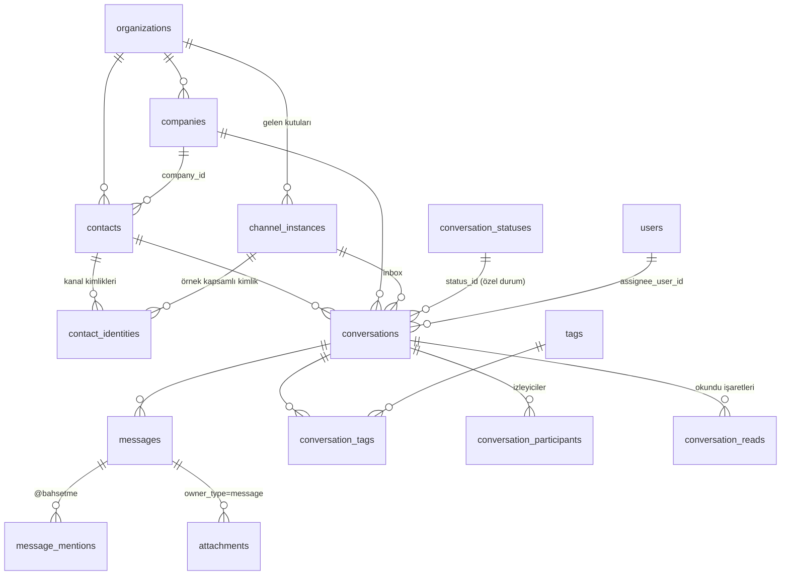

# Konuşma veri modeli (CF-25)

ClickFix'te temel nesne **konuşmadır**. "Talep" ayrı bir tablo değildir: durum, SLA ve atama taşıyan
konuşmanın kendisidir. Sohbet, sosyal DM'ler, e-posta ve web widget aynı tablolarda yaşar.

Migration: `backend/migrations/000034_conversations.up.sql` · Sorgular:
`backend/internal/database/queries/{contacts,channel_instances,conversations}.sql` · Depo:
`backend/internal/modules/conversations/repository`.

## ERD

## Kararlar

| Konu | Karar | Neden |
|------|-------|-------|
| Kiracı güvenliği | Her alt tablo üst tabloya `(organization_id, id)` bileşik FK ile bağlı | Bir satır başka organizasyonun kaydına işaret edemez; DB seviyesinde garanti (takwim `messaging_*` deseni). |
| Gelen kutusu | `channel_instances` = inbox | Chatwoot'taki inbox kavramı; organizasyonun bağladığı her hesap (WhatsApp numarası, IG hesabı, posta kutusu, widget) bir inbox. |
| Durum | `status` sabit taban kategori (`open, pending, snoozed, resolved, closed`); `status_id` opsiyonel özel durum | Ürün mantığı (SLA, snooze, yeniden açılma) taban kategoriye bakar; organizasyon "Tedarikçi bekleniyor" gibi kendi adlarını kategoriye bağlar (Laravel `TicketStatus.is_terminal` fikri). |
| Numara | `conversation_counters` ile organizasyon başına artan `#numara` | Destek ekipleri "#1042" ile konuşur; global id sızdırılmaz. |
| Ekip | `assignee_team_id` şimdilik FK'siz | Ekipler (CF-5) ayrı iş; tablo gelince FK eklenecek. |
| SLA | `sla_policy_id`, `first_response_due_at`, `next_response_due_at`, `resolution_due_at`, `sla_breached_at` | SLA motoru (CF-46) yazar; `first_response_at` ve `waiting_since` mesaj eklenirken depo tarafından tutulur. |
| Mesaj yönü | `in` / `out` / `internal` | İç not ve sistem olayı `internal`; `private` sadece `internal` ile mümkün (CHECK). |
| İdempotens | `(organization_id, channel_instance_id, external_id)` ve `(organization_id, conversation_id, client_id)` benzersiz | Tekrar gelen webhook ve tekrar denenen iyimser gönderim tek satır kalır. Adaptörler `external_id`'yi örnek içinde benzersiz üretir (ör. Telegram `chat:mesaj`). |
| Teslim durumu | `pending → queued → sent → delivered → read`, `failed`; sadece ileri gider | Sağlayıcı makbuzları sırasız gelir; geç gelen "delivered" bir "read"i geri almaz. |
| Ekler | `attachments.owner_type='message'`, `owner_id = messages.uuid` | CF-11 ek tablosu polimorfik; şema değişikliği gerekmez. |
| Okunmamış | `conversation_reads.last_read_message_id` (temsilci başına) | Okunmamış = işaretten sonraki, temsilcinin kendisinin yazmadığı, iç olmayan mesajlar. |
| Kişi birleştirme | `contacts.merged_into_id` + soft delete; kimlikler, konuşmalar, mesajlar taşınır | CF-84; birleştirilen kişinin kimliğiyle gelen yeni mesaj hayatta kalan kişiye gider. |
| Kişi çözümleme | Önce kimlik, sonra e-posta/telefon eşleşmesi, sonra yeni kişi; advisory lock ile | Aynı anda gelen iki webhook iki kişi yaratmaz. |
| Gelen mesajla yeniden açılma | `snoozed`/`resolved` konuşmaya gelen mesaj onu `open` yapar; `closed` yeni konuşma başlatır (pipeline kararı) | Chatwoot ve Laravel davranışı. |

## Gelen kutusu indeksleri

- `(organization_id, status, last_message_at DESC)` — durum sekmeleri
- `(organization_id, assignee_user_id, status, last_message_at DESC)` — "Bana atananlar", "Atanmamış"
- `(organization_id, assignee_team_id, …)`, `(organization_id, channel_instance_id, …)` — ekip ve inbox görünümleri
- `(organization_id, contact_id, last_message_at DESC)` — kişi geçmişi
- `snoozed_until WHERE status='snoozed'` — erteleme uyandırıcı
- `custom_fields` GIN — özel alan filtreleri (CF-7)
- `messages (organization_id, conversation_id, id DESC)` — mesaj listesinde keyset sayfalama
